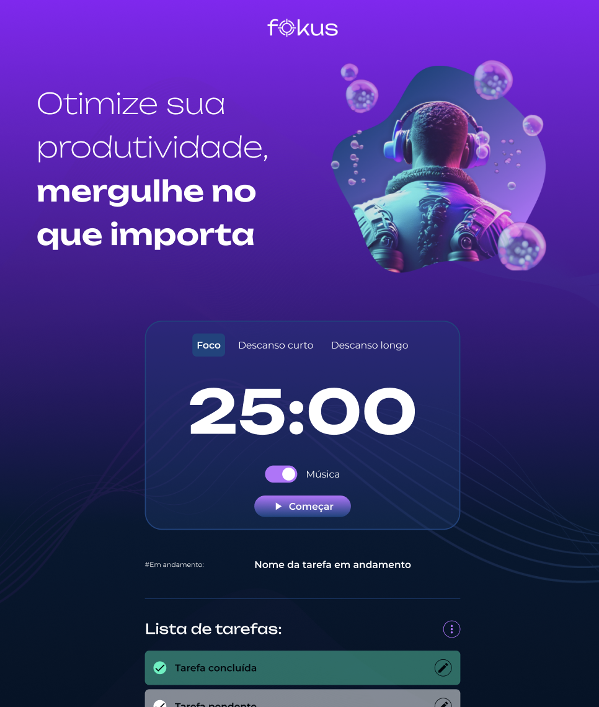

# Fokus

Estrutura inicial do projeto criada a partir do curso "JavaScript: manipulando elementos no DOM" da Alura e evoluído com o curso "JavaScript: explorando a manipulação de elementos e da localStorage", Com foco em interação de elementos, gerenciamento de eventos, persistência de dados com LocalStorage.

## 🔨 Funcionalidades do projeto

Este projeto, inspirado na técnica Pomodoro, que consiste em focar em uma tarefa por um período determinado seguido por pausas curtas ou longas para descanso, foi desenvolvido para melhorar a concentração em tarefas com controle de tempo sons e música.
Com funcionalidades completas de CRUD (Create, Read, Update, Delete), a aplicação permite adicionar, editar, visualizar e remover tarefas de forma prática e dinâmica.
Além disso, utiliza manipulação do DOM, eventos personalizados e técnicas de debug para garantir uma experiência fluida. O controle de estado e a persistência dos dados são feitos via LocalStorage, mantendo as tarefas salvas mesmo após o recarregamento da página.

💡 _Este projeto foi uma das etapas em que explorei diferentes formas de estruturar a organização de pastas e arquivos. Hoje sigo um padrão mais consistente, mas deixei essa versão visível para mostrar meu processo de aprendizado_

## ✔️ Técnicas e tecnologias utilizadas

🧪 Tecnologias:
- **HTML5 e CSS3** para a estrutura e estilização da interface;
- **JavaScript** para lógica, manipulação do DOM e interação;
- **Módulos JavaScript** (import/export) para organização do código.

⚙️ Técnicas e Funcionalidades Aplicadas:
- Manipulação de atributos no DOM: `getAttribute,` `setAttribute,` `hasAttribute,` `removeAttribute;`
- Controle de classes e elementos visuais com `classList.add` e `classList.remove` e `classList.toggle;`
- Criação de cronômetro com `setInterval()` e `clearInterval();`
- Tratamento de eventos com `addEventListener()` e eventos personalizados `CustomEvent;`
- Criação de estrutura modular (arquivos separados por responsabilidade);
- Controle de áudio com objetos `Audio();`
- Uso de LocalStorage para salvar e recuperar dados no navegador;
- Conversão de dados com `JSON.stringify()` e `JSON.parse();`
- Aplicação de funções diretas e indiretas para modularizar e organizar o código;
- Utilização de propriedades de objetos para acessar e manipular dados de forma dinâmica;
- Aplicação de técnicas de `debugg` para identificar e corrigir erros no código;
- Uso de `new Date()` e `toLocaleTimeString()` para formatação de tempo.

## 📁 Acesso ao projeto

Você pode [ acessar o Fokus através deste link](https://fokus-delta-five.vercel.app/) 
